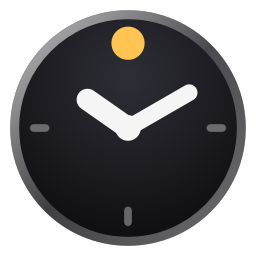
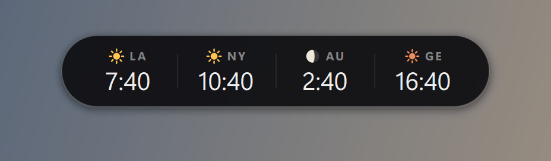
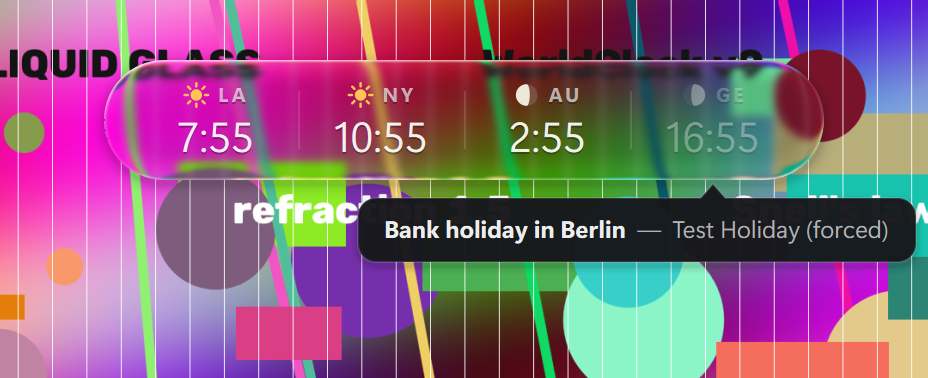
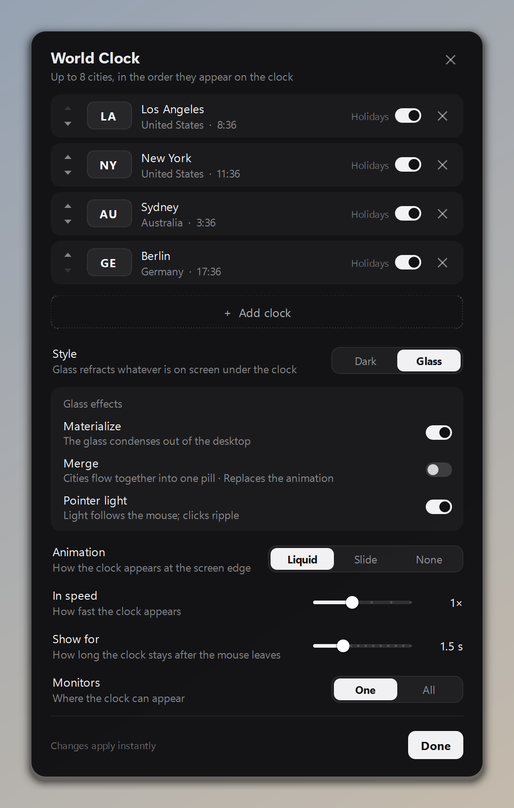

# WorldClock



A small always-on-top world clock for Windows that lives tucked against the
edge of your screen. Push the mouse against the edge and a liquid drop drips
out and spreads into a pill showing the time in your cities; move away and it
slides back in. Nothing on screen the rest of the time.






## Features

- **Edge-hidden island**: invisible until the mouse touches the screen edge
  above (or below) it. Drag it along the edge, to the bottom half of a screen
  to dock at the bottom, or onto another monitor.
- **1-8 cities from 308**, each with a 3-letter label. Sun by day, an orange
  sun at twilight, and the moon in its current phase at night.
- **Bank holidays per region** (e.g. California, New York, NSW, Berlin): the
  column dims on a holiday and the name shows on hover. Toggle per clock.
- **Animations**: Liquid (an SDF drop with a neck that pinches and snaps),
  Slide (a soft spring), or None.
- **Styles**: Dark, or **Liquid Glass**, which refracts whatever is on
  screen under the pill (squircle lens, RGB dispersion, frost, specular rim,
  light/dark text picked from the backdrop).
- **Glass effects** (Glass style only): Materialize, Merge (one blob per city
  flowing together) and Pointer light (a rim light that follows the cursor;
  clicks squish and ripple).
- **Show for** and **In speed** sliders: how long it stays after the mouse
  leaves (0 s - 1 min) and how fast it appears (0.5x - 2x).
- **Multi-monitor**: one pill, or one on every screen at the same spot.
- Tray icon with Settings, Pin open, Reset position and Start with Windows.



> **Note:** in Glass style the pill is excluded from screenshots and screen
> recordings on purpose (`WDA_EXCLUDEFROMCAPTURE`): it has to grab the screen
> under itself without seeing itself. Use Dark style if you want it to show up
> in captures.

## Install

1. Download **`WorldClock-Setup-*.exe`** from the [Releases page](../../releases)
   and run it. It installs per user (no admin) into
   `%LOCALAPPDATA%\Programs\WorldClock`, with an optional "Start with Windows".
2. Push your mouse against the top edge of the screen, centred, to bring it out.
   Right-click the tray icon (or the clock) for Settings.

Prefer no installer? Grab the `.zip` from the same page, unzip anywhere and
run `WorldClock.exe`.

Settings are kept in `%APPDATA%\WorldClock\settings.json` and survive
upgrades and uninstalls. Windows 10/11, 64-bit. The installer isn't
code-signed, so SmartScreen may ask you to confirm.

## Run from source

```bat
py -3.13 -m pip install -r requirements.txt
pythonw worldclock.pyw
```

Debug flags (from source or the exe):

```bat
python worldclock.pyw --dump
python worldclock.pyw --screenshot out.png [--style glass --bg image.png] [--clocks 6]
python worldclock.pyw --screenshot out.png --force-holiday GE --force-night
python worldclock.pyw --frames DIR [--anim liquid|slide|none] [--edge bottom]
python worldclock.pyw --settings-shot out.png [--search tokyo]
```

## Build

```bat
python -m venv .venv
.venv\Scripts\activate
pip install -r requirements-build.txt
build.bat
```

This makes `dist\WorldClock\` (PyInstaller onedir), a zip in `releases\` and,
if [Inno Setup 6](https://jrsoftware.org/isdl.php) is installed, the installer
in `installer_out\`. Pushing a `v*` tag builds and publishes a Release through
GitHub Actions. `tools/make_icon.py` redraws `icon.ico`;
`tools/build_cities.py` rebuilds and validates `cities.json`.

## Credits

The Liquid Glass look follows Apple's description of the material and these
write-ups and open-source experiments:

- Apple: [Adopting Liquid Glass](https://developer.apple.com/documentation/technologyoverviews/adopting-liquid-glass),
  [Glass](https://developer.apple.com/documentation/swiftui/glass)
- kube.io: [Liquid Glass in CSS/SVG](https://kube.io/blog/liquid-glass-css-svg/) (squircle bevel and Snell's-law lens profile)
- [rdev/liquid-glass-react](https://github.com/rdev/liquid-glass-react),
  [rizroze/liquid-glass](https://github.com/rizroze/liquid-glass),
  [MarcosDemik/liquidglass](https://github.com/MarcosDemik/liquidglass),
  [shuding/liquid-glass](https://github.com/shuding/liquid-glass) (displacement maps and chromatic split)

Built with [PySide6](https://doc.qt.io/qtforpython-6/),
[holidays](https://github.com/vacanza/holidays),
[astral](https://github.com/sffjunkie/astral), [tzdata](https://github.com/python/tzdata),
[NumPy](https://numpy.org/) and [OpenCV](https://opencv.org/).

## License

[GPL-3.0](LICENSE) © Mario Domingos
